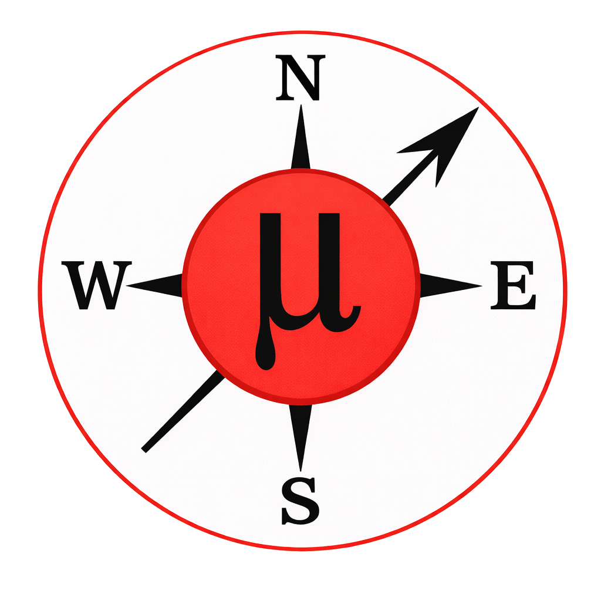

MuFinder Documentation
======================

MuFinder is a PySide6 desktop application for muon stopping-site workflows.
This documentation covers the implemented architecture, scientific generation
features, and quality standards that must be maintained as development expands.

.. toctree::
   :maxdepth: 2
   :caption: Contents

   implemented_functionality
   supercells
   journal
   site_generation
   uep_workflow
   comparison_table
   quality_and_automation
   project_specification
   hpc_security_audit
   api
